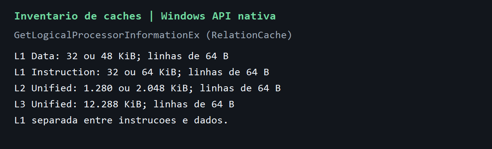
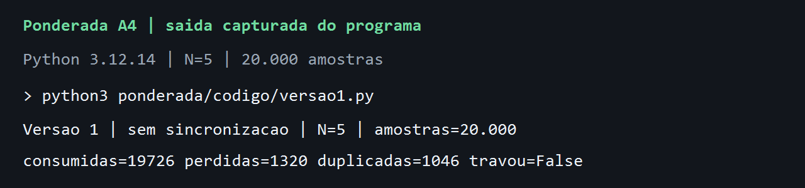
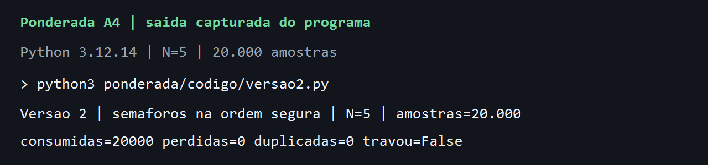
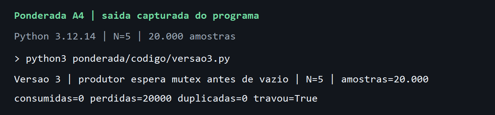

Nicole Riedla Paiva Neves | D1=6 | D2=2 | N=5

# Ponderada CC08 do pipeline ao deadlock

## Parâmetros individuais

Contando apenas letras, Nicole tem 6 letras. O nome completo tem 6 + 6 + 5 + 5 = 22 letras. Portanto, D1=6 e D2 é o último dígito de 22, ou seja, 2. O buffer tem N = 3 + (2 mod 5) = 5 posições.

| Parâmetro | Cálculo | Valor usado |
|---|---:|---:|
| Instruções por amostra (IC) | 100.000 + 20.000 x 2 | 140.000 |
| Taxa de falta L1 (m) | 3% + 0,5% x 6 | 6% |
| Buffer circular (N) | 3 + (2 mod 5) | 5 |

## Parte A — problema técnico

### A1. Arquitetura e memória

**Plataforma H.** Com CPI de 1,5 e clock de 48 MHz:

`tempo = IC x CPI / frequência = 140.000 x 1,5 / 48.000.000 = 0,004375 s = 4,375 ms`

Ela atende ao limite de 5 ms, com 0,625 ms de margem no modelo.

**Plataforma V.** O acesso acerta a cache em 1 ciclo e uma falta custa 120 ciclos:

`AMAT = 1 + (m x penalidade) = 1 + (0,06 x 120) = 8,2 ciclos por acesso`

Usando a fórmula de CPI dada no enunciado:

`CPI efetivo = 1 + (1,3 x 0,06 x 120) = 10,36`

`tempo por amostra = 140.000 x 10,36 / 1.200.000.000 = 0,0012083 s = 1,208 ms`

No pior caso modelado pelo atraso do Linux:

`1,208 ms + 3 ms = 4,208 ms`

A V atende aos 5 ms nesse modelo, com 0,792 ms de margem no pior caso.

**Acelerador DSP na H.** O filtro é 60% do tempo e fica cinco vezes mais rápido:

`speedup global = 1 / ((1 - 0,60) + (0,60 / 5)) = 1 / 0,52 = 1,923`

`novo tempo = 4,375 ms / 1,923 = 2,275 ms`

Com o DSP, a H atende ao limite com 2,725 ms de margem no modelo.

Para produção, escolheria a H com DSP: a V também atende no modelo, mas a H com DSP tem mais margem e não recebe interrupções de um sistema operacional.

A V precisa de cache porque sua DRAM externa custa 120 ciclos em cada falta; a cache reduz o tempo médio desse acesso. Como instruções e dados passam pela mesma memória, eles disputam o caminho de Von Neumann. A H usa SRAM interna de um ciclo e caminhos separados de instruções e dados, então não precisa de cache para cumprir esse papel.

**Caches deste computador.** O CPU-Z não está instalado aqui. Registrei o inventário de caches pela API nativa do Windows `GetLogicalProcessorInformationEx (RelationCache)`. A consulta encontrou caches L1 de instruções separados dos caches L1 de dados; as capacidades variam entre tipos de núcleo: L1 de dados de 32 ou 48 KiB, L1 de instruções de 32 ou 64 KiB, L2 unificada de 1.280 ou 2.048 KiB e L3 unificada de 12.288 KiB. Como a L1 é dividida, a CPU usa uma organização Harvard nesse nível. Como instruções e dados ainda compartilham a memória principal e o espaço de endereçamento, a classificação do computador completo é Harvard modificada.



### A2. Pipeline do loop do filtro

As dependências RAW entre instruções do trecho são:

| Produtora | Consumidora | Registrador | Motivo |
|---|---|---|---|
| 1 `lw x5, 0(x10)` | 2 `add x6, x6, x5` | x5 | O `add` soma a amostra carregada. |
| 2 `add x6, x6, x5` | 4 `sub x6, x6, x7` | x6 | O `sub` usa a soma parcial. |
| 3 `lw x7, 0(x11)` | 4 `sub x6, x6, x7` | x7 | O `sub` subtrai a amostra antiga carregada. |
| 4 `sub x6, x6, x7` | 5 `sw x6, 0(x12)` | x6 | O `sw` grava a soma atualizada. |

O `add` também lê o valor anterior de x6, que vem da iteração anterior do loop; essa dependência atravessa amostras e não é uma RAW entre duas instruções deste trecho.

No diagrama, `F=IF`, `D=ID`, `X=EX`, `M=MEM`, `W=WB` e `.` indica ciclo sem estágio para aquela instrução. Um estágio repetido representa uma instrução parada. O banco escreve na primeira metade do ciclo e lê na segunda metade; por isso uma instrução pode ler no ciclo em que a produtora faz WB.

**Sem forwarding.** As consumidoras esperam os valores chegarem a WB: cada uma das dependências 1→2, 2→4 e 4→5 acrescenta duas bolhas. São seis ciclos de bolha; o trecho termina no WB da instrução 7, no ciclo 17.

```text
ciclo  01 02 03 04 05 06 07 08 09 10 11 12 13 14 15 16 17
I1 lw  F  D  X  M  W  .  .  .  .  .  .  .  .  .  .  .  .
I2 add .  F  D  D  D  X  M  W  .  .  .  .  .  .  .  .  .
I3 lw  .  .  F  F  F  D  X  M  W  .  .  .  .  .  .  .  .
I4 sub .  .  .  .  .  F  D  D  D  X  M  W  .  .  .  .  .
I5 sw  .  .  .  .  .  .  F  F  F  D  D  D  X  M  .  .  .
I6 x10 .  .  .  .  .  .  .  .  .  F  F  F  D  X  M  W  .
I7 x11 .  .  .  .  .  .  .  .  .  .  .  .  F  D  X  M  W
```

**Com forwarding.** O valor do `lw` só fica disponível ao final de MEM. Por isso, as dependências 1→2 e 3→4 ainda exigem uma bolha cada. A dependência do `sub` para o dado do `sw` é atendida encaminhando o resultado até MEM. O trecho termina no WB da instrução 7, no ciclo 13.

```text
ciclo  01 02 03 04 05 06 07 08 09 10 11 12 13
I1 lw  F  D  X  M  W  .  .  .  .  .  .  .  .
I2 add .  F  D  D  X  M  W  .  .  .  .  .  .
I3 lw  .  .  F  F  D  X  M  W  .  .  .  .  .
I4 sub .  .  .  .  F  D  D  X  M  W  .  .  .
I5 sw  .  .  .  .  .  F  F  D  X  M  .  .  .
I6 x10 .  .  .  .  .  .  .  F  D  X  M  W  .
I7 x11 .  .  .  .  .  .  .  .  F  D  X  M  W
```

**Reordenação com forwarding.** Para deixar instruções independentes entre cada `lw` e seu consumidor, e conservar a escrita do resultado, uso esta ordem:

1. `lw x5, 0(x10)`
2. `lw x7, 0(x11)`
3. `addi x10, x10, 4`
4. `add x6, x6, x5`
5. `sub x6, x6, x7`
6. `sw x6, 0(x12)`
7. `addi x11, x11, 4`

A atualização de x11 pode ocorrer depois do `sw`, pois o endereço do `sw` usa x12. As cargas acontecem antes de seus ponteiros avançarem. O forwarding cobre a dependência entre `add` e `sub` e leva o resultado do `sub` ao dado do `sw`. Não há bolhas; o último WB ocorre no ciclo 11.

```text
ciclo   01 02 03 04 05 06 07 08 09 10 11
I1 lw   F  D  X  M  W  .  .  .  .  .  .
I2 lw   .  F  D  X  M  W  .  .  .  .  .
I3 x10 .  .  F  D  X  M  W  .  .  .  .
I4 add  .  .  .  F  D  X  M  W  .  .  .
I5 sub  .  .  .  .  F  D  X  M  W  .  .
I6 sw   .  .  .  .  .  F  D  X  M  .  .
I7 x11 .  .  .  .  .  .  F  D  X  M  W
```

### A3. Processos e threads

Na Plataforma V, manteria leitura, processamento e acionamento do motor como threads do mesmo processo de tempo real. Elas compartilham as amostras sem IPC e têm custo baixo de criação e troca de contexto; também permitem que o processamento e a vibração usem os mesmos buffers. O BLE ficaria em um processo separado, com IPC para receber comandos e enviar logs. O custo de uma fronteira de processo é adequado para esse tráfego menos urgente e isola a tarefa que recebe dados externos.

Se uma falha no BLE for explorada, um processo separado limita o acesso à memória e permite encerrar ou reiniciar o módulo sem derrubar a leitura e a vibração. Como thread do processo principal, o módulo compartilharia o espaço de endereçamento e poderia corromper o estado da amostra ou parar o processo inteiro.

```text
                 preempção / fim do quantum
              +-------------------------------+
              |                               v
         +---------+     despacho       +-------------+
         | Pronto  | -----------------> | Executando  | -----> Terminado
         +---------+                    +-------------+
              ^                              |
              |         evento concluído     | espera por sensor/timer
              +------------------------------v
                                        +-----------+
                                        | Bloqueado |
                                        +-----------+
```

A thread do sensor passa a maior parte do tempo bloqueada à espera da interrupção ou do timer da próxima amostra de 10 ms. Ao chegar o evento, ela passa para pronta e executa a leitura brevemente.

### A4. Código com semáforos

O N utilizado é 5. Cada execução processa 20.000 IDs, de 0 a 19.999. A perda é o número de IDs esperados que não apareceram; duplicadas são ocorrências extras de IDs já vistos. “Consumidas” conta todas as leituras válidas, incluindo repetidas.

| Versão | Execução | Consumidas | Perdidas | Duplicadas | Travou |
|---|---:|---:|---:|---:|---|
| 1, sem sincronização | 1 | 19.726 | 1.320 | 1.046 | Não |
| 1, sem sincronização | 2 | 20.300 | 991 | 1.291 | Não |
| 1, sem sincronização | 3 | 19.637 | 829 | 466 | Não |
| 2, semáforos na ordem segura | 1 | 20.000 | 0 | 0 | Não |
| 2, semáforos na ordem segura | 2 | 20.000 | 0 | 0 | Não |
| 2, semáforos na ordem segura | 3 | 20.000 | 0 | 0 | Não |
| 3, mutex antes de vazio | 1 | 0 | 20.000 | 0 | Sim |
| 3, mutex antes de vazio | 2 | 0 | 20.000 | 0 | Sim |
| 3, mutex antes de vazio | 3 | 0 | 20.000 | 0 | Sim |

Uma execução de cada versão:







Na versão 1, a região crítica inclui a leitura e atualização de `occupied` e a operação correspondente no buffer e nos índices. Sem exclusão mútua, produtor e consumidor podem ler o mesmo valor antigo, ceder a CPU em `time.sleep(0)` e gravar atualizações incompatíveis. O contador deixa de representar o número real de posições ocupadas; o produtor pode sobrescrever dados ainda não lidos e o consumidor pode encontrar IDs repetidos. As três rodadas mostram perdas e duplicações.

Na versão 2:

- `vazio` começa em N e impede o produtor de escrever quando não há posição livre.
- `cheio` começa em 0 e impede o consumidor de ler quando não há amostra.
- `mutex` começa em 1 e protege o buffer e os índices durante cada leitura ou escrita.

As três rodadas consumiram os 20.000 IDs exatamente uma vez. Na versão 3, o produtor adquire `mutex` enquanto o buffer está cheio e depois espera por `vazio`. O consumidor já pode retirar um token de `cheio`, mas fica esperando o mesmo `mutex`; sem o consumidor liberar uma posição, o produtor também não prossegue. As três execuções ficaram travadas antes da primeira leitura.

### A5. Deadlock

Uma sequência possível é:

1. `thread_sensor` executa P(i2c), lê o sensor e mantém i2c; depois pede log.
2. `thread_log` executa P(log), lê o arquivo e mantém log; depois pede ble.
3. `thread_config` executa P(ble), recebe o comando e mantém ble; depois pede i2c.
4. As três ficam bloqueadas, cada uma esperando um recurso retido pela próxima.

Grafo de alocação naquele instante:

```text
[i2c] -> (thread_sensor) -> [log] -> (thread_log) -> [ble] -> (thread_config) -> [i2c]
```

As quatro condições necessárias aparecem assim:

1. **Exclusão mútua:** cada semáforo protege um recurso exclusivo: i2c, log ou ble.
2. **Posse e espera:** cada thread segura o primeiro recurso enquanto pede o segundo.
3. **Não preempção:** o recurso só é liberado quando a thread executa V; outra thread não o toma à força.
4. **Espera circular:** sensor espera log, log espera ble e config espera i2c, fechando o ciclo.

**Correção preventiva — ordem global.** Definir a ordem i2c < log < ble e exigir que todas as threads adquiram recursos nessa ordem. `thread_config` passaria a pedir i2c antes de ble. Como nenhum fluxo pode voltar a um recurso anterior da ordem, o ciclo deixa de existir. Para a pessoa, a leitura e a vibração continuam; um comando BLE pode aguardar a aquisição do i2c por alguns milissegundos.

**Detecção e recuperação — prazo com rollback.** Fazer cada aquisição bloqueante ter um prazo, por exemplo 100 ms. Ao expirar, a thread abandona a operação, libera na ordem inversa todos os recursos que ela própria adquiriu e tenta de novo com atraso curto; o evento fica registrado para diagnóstico. Assim, uma combinação que formaria deadlock não congela a pulseira indefinidamente. O usuário pode perceber atraso ou repetição de um comando de configuração, enquanto a leitura prioritária e a vibração permanecem disponíveis.

## Parte B — decisão do CTO

**Decido produzir a pulseira com a Plataforma H e o DSP.** O custo de hardware será R$ 37 por unidade, R$ 33 abaixo da Plataforma V, e o cálculo da A1 reduz o tempo estimado de 4,375 ms para 2,275 ms por amostra, deixando 2,725 ms de margem até o limite de 5 ms.

Abro mão de atualizações OTA: a equipe de assistência e quem precisar de uma correção terão de levar a pulseira para atualizar por cabo. Em troca, a execução não depende de um escalonador Linux no caminho crítico e o produto evita a superfície de ataque adicional de um sistema operacional completo. BLE e comandos externos ainda exigirão validação e firmware assinado.

Para a pessoa que usa a pulseira, a decisão favorece vibração previsível e menor custo, mas pode prolongar a exposição a uma falha corrigível por software até a visita à assistência. Eu mudaria a decisão se um ensaio de 200.000 amostras, sob os extremos especificados de temperatura e tensão, registrasse qualquer amostra acima de 5 ms; nesse caso, suspenderia a produção H e qualificaria a Plataforma V com escalonamento de tempo real medido.
